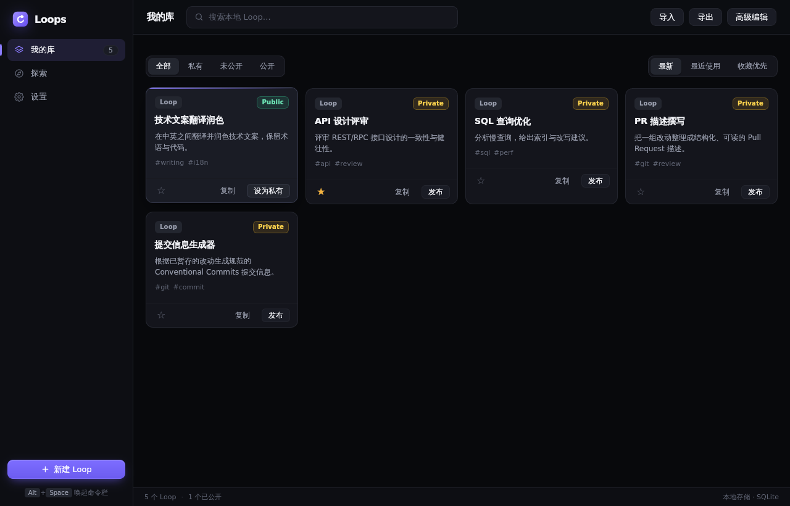
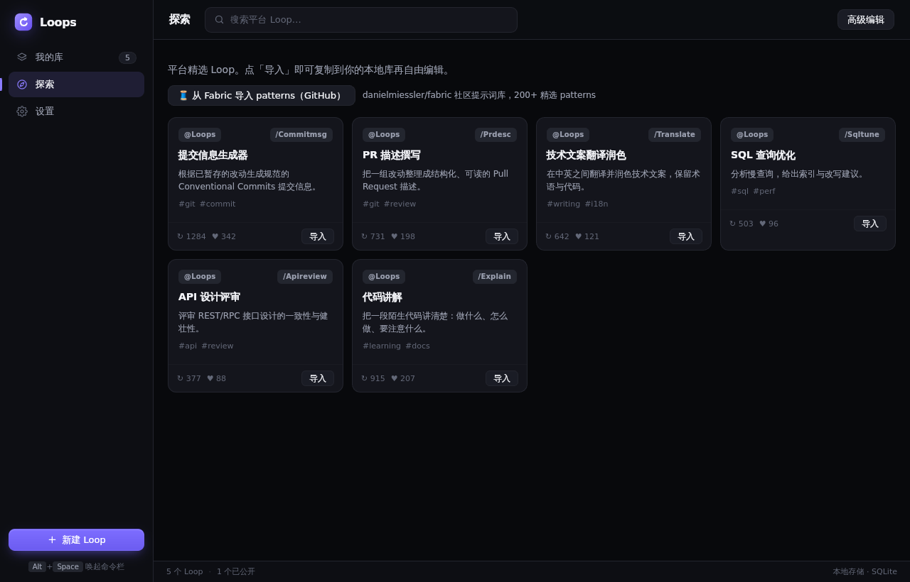
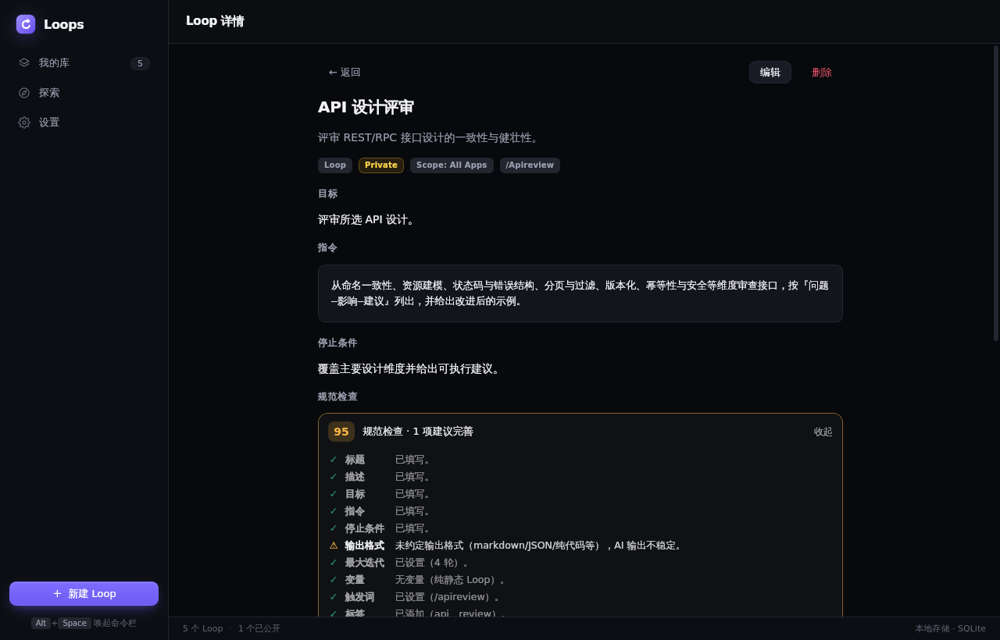
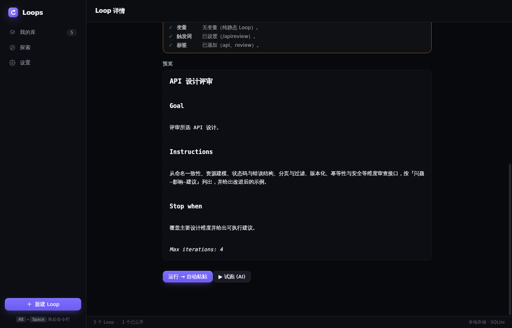
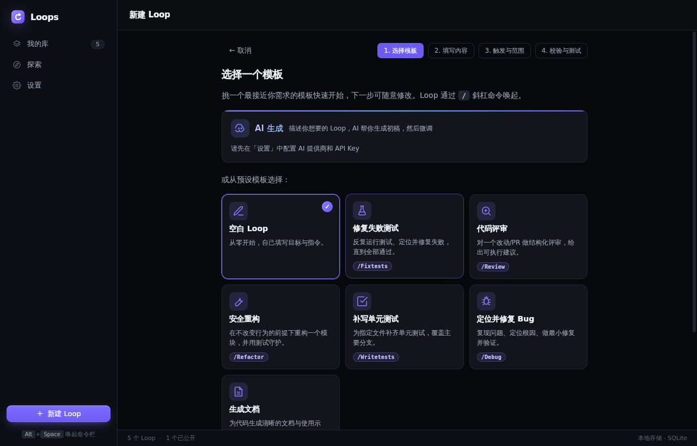
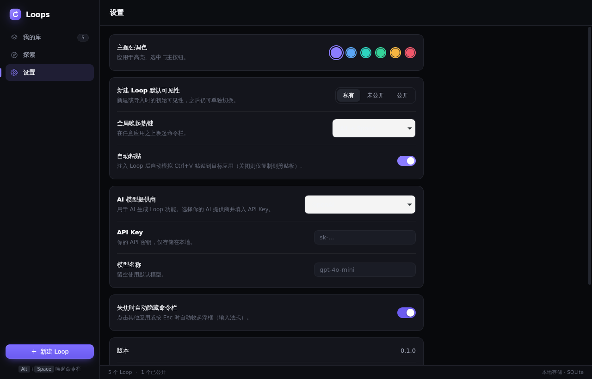

# Loops Desktop

A hotkey-driven command bar for browsing, creating, and injecting reusable AI
assets into the AI apps you already use (Claude Code, Cursor, Codex, Gemini CLI,
OpenCode). Inspired by the agent-loop catalog at
[loops.elorm.xyz](https://loops.elorm.xyz/), reimagined as a local-first desktop
app with a Raycast/Alfred-style quick panel.

Everything lives in a local SQLite database — no account, no server, no sync.
The AI features are optional and only call the provider you configure with your
own API key.

## Screenshots

**Library** — your local loop collection with search, visibility filters,
sort/favorites, import/export and one-click copy.



**Discover** — a built-in curated catalog plus import of
[Fabric](https://github.com/danielmiessler/fabric) patterns as local loops.



**Loop detail** — fields, trigger/scope, a standardness lint score with an
actionable checklist, a live rendered preview, and run / AI dry-run actions.




**New Loop wizard** — start from a starter template or let AI draft the loop,
then fill content, triggers/scope and validate before saving.



**Settings** — accent color, default visibility, global hotkey, auto-paste, AI
provider/model/key, and local data management.



## Features

- **Local loop library** — create, edit, duplicate, delete; search by title,
  description, tags or trigger; filter by visibility; sort by updated / recently
  used / favorites first.
- **Guided wizard** — 4 steps (template → content → trigger & scope → validate),
  with starter templates (fix tests, code review, safe refactor, write tests,
  debug, document) and an optional AI draft.
- **Prompt-engineering fields** — goal, instructions, stop condition, max
  iterations, output format, constraints, context, few-shot examples, variables,
  and a per-loop model override.
- **Standardness lint** — a score plus a checklist of what is missing or weak in
  a loop before you rely on it.
- **Command bar** — summoned by a global hotkey (`Alt+Space` by default,
  configurable), filters loops by query or `/` trigger, collects variable
  values, renders the template and injects the result via the clipboard
  (optionally auto-pasting into the previously focused app).
- **AI dry-run** — run a loop against your configured provider (OpenAI,
  Anthropic, DeepSeek, Gemini or any OpenAI-compatible custom base URL), with
  iteration control, `[DONE]` stop detection and Markdown/GFM rendered replies.
- **Discover & Fabric import** — install curated loops (commit messages, PR
  descriptions, technical translation, SQL tuning, API design review, code
  explanation) or convert Fabric patterns into local loops.
- **Import / export** — move your library between machines as JSON.
- **Usage tracking** — favorites, recent list, copy counts and last-used time.

## Core concept: Assets

Everything reusable is modeled as an **Asset**, discriminated by `kind`
(`loop | prompt | context | command | persona | snippet | rule`). Only `loop`
is implemented today; new kinds are added by introducing a new payload type and
an editor/renderer — the core store, types, and command bar stay unchanged.

A **Loop** is a goal-directed iterative routine: `goal`, `instructions`, an
optional `stopCondition`, `maxIterations`, and template `variables` that are
filled in just before injection.

Each asset also carries a `visibility` (`private | unlisted | public`). Today
this is only local metadata — publishing is a local flag, there is no remote
marketplace yet.

## How a run works

1. Press the global hotkey — the command bar appears and the foreground app is
   recorded first, so scope filtering can resolve the real target app.
2. Type a query or a `/` trigger to pick a loop.
3. Fill the loop's variables in the popup form.
4. The template is rendered, copied to the clipboard, and (with auto-paste
   enabled) pasted into the app you came from; usage is recorded locally.

Alternatively, open a loop in the library and use **AI dry-run** to iterate on it
inside the app before injecting it anywhere.

## Architecture

| Layer | Tech | Responsibility |
|-------|------|----------------|
| Backend | Rust (Tauri v2) | SQLite persistence (`store.rs`), OS bridge for hotkey/foreground/clipboard (`osbridge.rs`), IPC commands including AI/Fabric HTTP calls (`commands.rs`) |
| Frontend | React 19 + TypeScript + Vite | Library window (browse/CRUD/discover/settings) and frameless Command Bar (hotkey-summoned search + inject) |

- **Library window** — browse the local loop collection, create/edit/delete,
  view loop detail with a live rendered preview.
- **Command Bar** — a frameless, transparent, always-on-top popup window that
  hides on blur or `Esc`.

The frontend/backend contract is a single `Asset` shape serialized as camelCase
JSON (`src/types/asset.ts` mirrors `src-tauri/src/model.rs`). Settings, presets
and usage stats are stored in the same SQLite database; API keys are kept
locally and never leave the machine except in requests to the provider you
configured.

## Develop

Prerequisites: Node 20+, Rust stable (an edition-2024-capable toolchain — run
`rustup update stable` if the build complains), and the platform's Tauri v2
prerequisites:

- **Windows** — MSVC build tools + WebView2 runtime.
- **macOS** — Xcode command line tools.
- **Linux** — `libwebkit2gtk-4.1-dev`, `libjavascriptcoregtk-4.1-dev`,
  `libgtk-3-dev`, `libayatana-appindicator3-dev`, `librsvg2-dev`, `libxdo-dev`,
  `patchelf`, `build-essential`.

```bash
npm install
npm run tauri dev     # launch the desktop app in dev mode
```

Useful checks:

```bash
npm run typecheck     # tsc --noEmit
npm run build         # tsc && vite build (frontend bundle)
cd src-tauri && cargo check
```

Package installers for the current platform:

```bash
npm run tauri build
```

## Project layout

```
src/                 React frontend
  types/asset.ts     Asset/Loop type contract (mirrors Rust model)
  lib/               IPC wrappers, template render, draft helpers, validation,
                     starter templates, discover catalog, settings, app catalog
  views/             LibraryApp, CommandBar
  components/        LoopCard, LoopDetail, LoopEditor, LoopWizard, VariableForm,
                     RunnerPanel, DiscoverCard, FabricImport, LintPanel,
                     SettingsView, Markdown, Toast, ConfirmDialog
src-tauri/src/       Rust backend
  model.rs           Asset/LoopPayload/VariableSpec/TriggerBinding/ScopeRule
  store.rs           SQLite persistence (rusqlite)
  commands.rs        Tauri IPC command handlers
  osbridge.rs        Foreground-app detection, clipboard paste simulation
  lib.rs             App setup: tray, global hotkey, windows
docs/screenshots/    README screenshots
```

## Scope & roadmap

Implemented today: the local **Loop** library end-to-end (wizard, editor, lint,
preview, favorites/recent, import/export), the hotkey command bar with clipboard
injection, the AI generator and dry-run runner, and the Discover/Fabric catalog.

Not implemented yet:

- the other asset kinds (`prompt`, `context`, `command`, `persona`, `snippet`,
  `rule`) — the model supports them, the UI does not,
- the `@ # !` trigger providers (only `/` is wired up),
- foreground-app scope filtering is captured but not yet enforced per loop,
- a public/remote marketplace — `visibility` is local metadata only.

## License

See [LICENSE](LICENSE).
