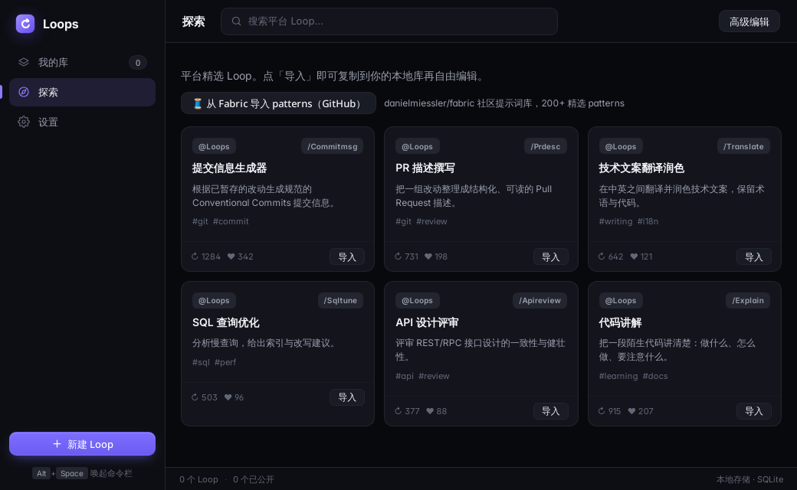
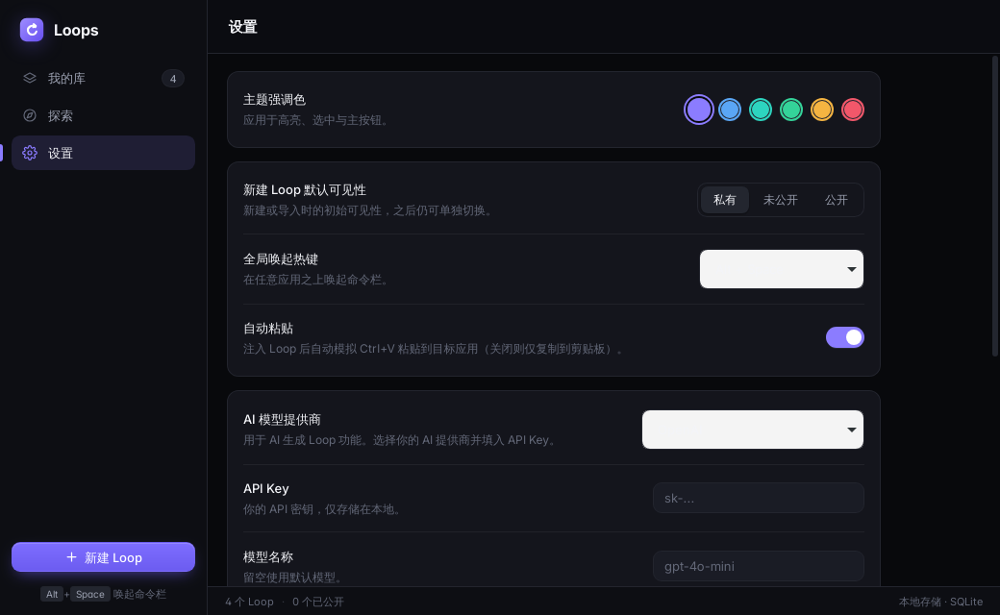

# Loops Desktop

[English](./README.md) | **简体中文**

热键驱动的命令栏，用于浏览、创建，并把可复用的 AI 资产注入你已在使用的 AI 应用（Claude Code、Cursor、Codex、Gemini CLI、OpenCode）。灵感来自 [loops.elorm.xyz](https://loops.elorm.xyz/) 的 agent loop 目录，做成了本地优先的桌面应用。

数据只存在本地 SQLite，没有账号，也没有云同步。AI 功能是可选的，只会调用你自己配置的服务商。

## 0.2.0 更新

增加可移植的 `.loops.json` 启动包（`src/packs/starter.loops.json`）：可以把内置模板打包、解析并往返序列化，不必打开 Tauri 文件对话框。许可证版权行未改。

## 功能

- 本地 Loop 库：创建、编辑、复制、删除；按标题、描述、标签或触发词搜索。
- 启动包：附带「修复测试」「代码评审」等现成模板，格式与导入导出信封兼容。
- 引导向导：模板 → 内容 → 触发与范围 → 校验。
- 可选 AI 草稿（需自备 API Key）。

## 界面截图

以下截图来自仓库中已有的本地运行记录，本轮没有重新截图。

**资料库**


**发现**



**设置**



## 验证

```bash
node --test test/focus-and-capabilities.test.cjs test/pack.test.cjs
```
