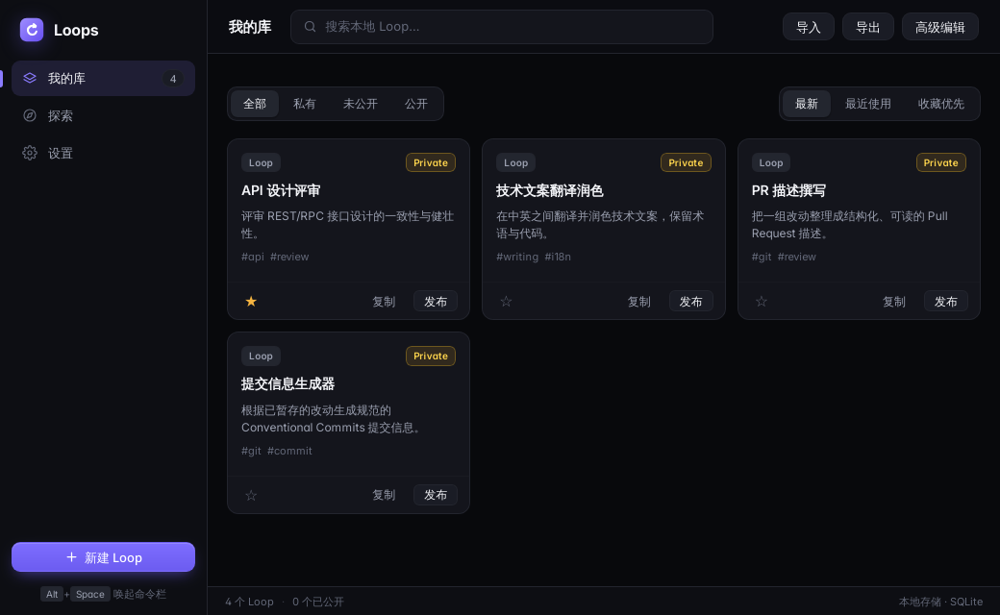
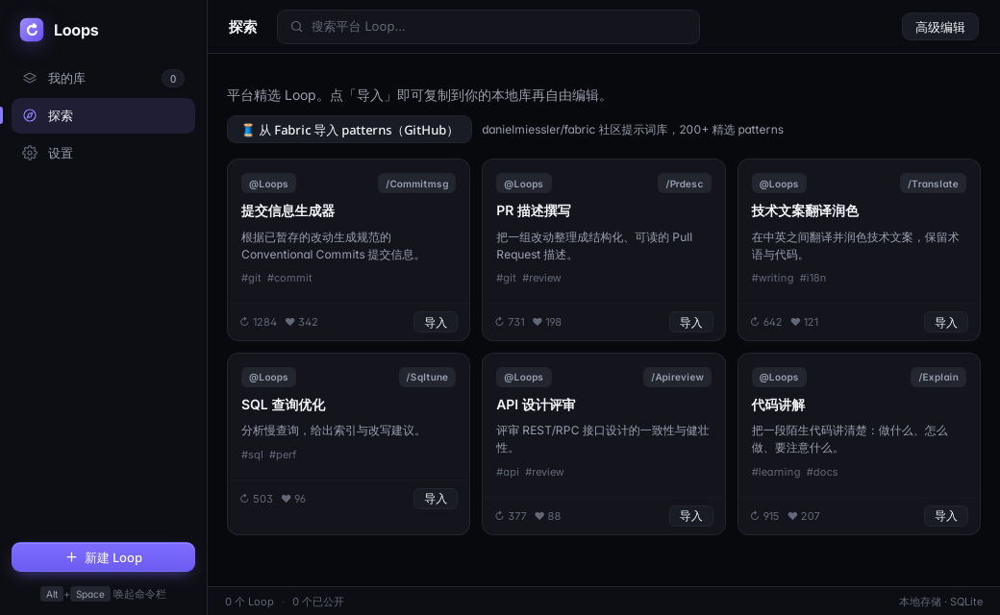
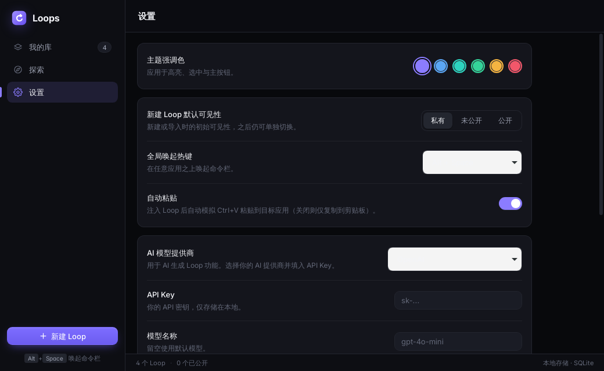

# Loops Desktop

[English](README.md) · **简体中文**

一个用快捷键唤出的命令栏，用来浏览、创建可复用的 AI 资产，并把它们注入你正在使用的 AI 应用（Claude Code、Cursor、Codex、Gemini CLI、OpenCode）。灵感来自 [loops.elorm.xyz](https://loops.elorm.xyz/) 的智能体循环目录，这里把它重新做成了本地优先的桌面应用，带 Raycast / Alfred 风格的快捷面板。

所有数据都保存在本地 SQLite 数据库中——无需账号、没有服务器、不做同步。AI 功能是可选的，只会调用你用自己的 API Key 配置的提供商。

## 界面截图

**资产库（Library）**：本地 loop 集合，支持搜索、可见性筛选、排序 / 收藏、导入导出和一键复制。



**发现（Discover）**：内置精选目录，并可把 [Fabric](https://github.com/danielmiessler/fabric) 的 pattern 导入为本地 loop。



**设置（Settings）**：强调色、默认可见性、全局快捷键、自动粘贴、AI 提供商 / 模型 / Key，以及本地数据管理。



> 截图中的界面为英文（应用当前只有英文界面）。

## 功能特性

- **本地 loop 库**：新建、编辑、复制、删除；按标题、描述、标签或触发词搜索；按可见性筛选；按更新时间 / 最近使用 / 收藏优先排序。
- **引导式向导**：4 步（模板 → 内容 → 触发与范围 → 校验），内置入门模板（修复测试、代码评审、安全重构、编写测试、调试、写文档），可选 AI 起草。
- **提示词工程字段**：目标、指令、停止条件、最大迭代次数、输出格式、约束、上下文、少样本示例、变量，以及每个 loop 单独的模型覆盖。
- **规范度检查（lint）**：给出分数和清单，指出 loop 中缺失或薄弱的部分。
- **命令栏**：全局快捷键唤出（默认 `Alt+Space`，可配置），按关键词或 `/` 触发词筛选 loop，收集变量值，渲染模板后通过剪贴板注入（可选自动粘贴到之前聚焦的应用）。
- **AI 试运行**：用你配置的提供商（OpenAI、Anthropic、DeepSeek、Gemini 或任意 OpenAI 兼容的自定义 Base URL）运行 loop，支持迭代控制、`[DONE]` 停止检测，回复以 Markdown / GFM 渲染。
- **发现与 Fabric 导入**：安装精选 loop（提交信息、PR 描述、技术翻译、SQL 调优、API 设计评审、代码讲解），或把 Fabric pattern 转为本地 loop。
- **导入 / 导出**：用 JSON 在不同机器之间迁移资产库。
- **使用统计**：收藏、最近使用列表、复制次数和最后使用时间。

## 核心概念：资产（Asset）

所有可复用的东西都建模为 **Asset**，用 `kind` 区分（`loop | prompt | context | command | persona | snippet | rule`）。目前只实现了 `loop`；新增类型只需加一个新的 payload 类型和对应的编辑器 / 渲染器——核心存储、类型和命令栏都不用改。

**Loop** 是一个以目标为导向的迭代流程：`goal`、`instructions`、可选的 `stopCondition`、`maxIterations`，以及在注入前填写的模板 `variables`。

每个资产还有 `visibility`（`private | unlisted | public`）。目前这只是本地元数据——“发布”只是一个本地标记，还没有远程市场。

## 一次运行的流程

1. 按下全局快捷键——命令栏出现，并先记录当前前台应用，以便范围筛选能识别真正的目标应用。
2. 输入关键词或 `/` 触发词选择 loop。
3. 在弹出的表单中填写 loop 的变量。
4. 模板被渲染并复制到剪贴板，（开启自动粘贴时）粘贴到你刚才所在的应用；使用记录保存在本地。

也可以在资产库中打开某个 loop，用 **AI 试运行** 在应用内迭代，满意后再注入到其他地方。

## 架构与技术栈

| 层 | 技术 | 职责 |
|-------|------|----------------|
| 后端 | Rust（Tauri v2） | SQLite 持久化（`store.rs`），快捷键 / 前台应用 / 剪贴板的系统桥接（`osbridge.rs`），包括 AI / Fabric HTTP 调用在内的 IPC 命令（`commands.rs`） |
| 前端 | React 19 + TypeScript + Vite | 资产库窗口（浏览 / 增删改 / 发现 / 设置）和无边框命令栏（快捷键唤出的搜索 + 注入） |

- **资产库窗口**：浏览本地 loop 集合、新建 / 编辑 / 删除，查看带实时渲染预览的 loop 详情。
- **命令栏**：无边框、透明、置顶的弹出窗口，失焦或按 `Esc` 时隐藏。

前后端之间只约定一种 `Asset` 结构，以 camelCase JSON 序列化（`src/types/asset.ts` 对应 `src-tauri/src/model.rs`）。设置、预设和使用统计保存在同一个 SQLite 数据库中；API Key 保存在本地，除了发往你所配置提供商的请求外不会离开本机。

## 开发

前置条件：Node 20+、Rust stable（需支持 edition 2024，构建报错时运行 `rustup update stable`），以及对应平台的 Tauri v2 依赖：

- **Windows**：MSVC 构建工具 + WebView2 运行时。
- **macOS**：Xcode 命令行工具。
- **Linux**：`libwebkit2gtk-4.1-dev`、`libjavascriptcoregtk-4.1-dev`、`libgtk-3-dev`、`libayatana-appindicator3-dev`、`librsvg2-dev`、`libxdo-dev`、`patchelf`、`build-essential`。

```bash
npm install
npm run tauri dev     # 以开发模式启动桌面应用
```

常用检查：

```bash
npm run typecheck     # tsc --noEmit
npm run build         # tsc && vite build（前端包）
cd src-tauri && cargo check
```

为当前平台打包安装程序：

```bash
npm run tauri build
```

## 项目结构

```
src/                 React 前端
  types/asset.ts     Asset / Loop 类型约定（与 Rust 模型对应）
  lib/               IPC 封装、模板渲染、草稿辅助、校验、
                     入门模板、发现目录、设置、应用目录
  views/             LibraryApp、CommandBar
  components/        LoopCard、LoopDetail、LoopEditor、LoopWizard、VariableForm、
                     RunnerPanel、DiscoverCard、FabricImport、LintPanel、
                     SettingsView、Markdown、Toast、ConfirmDialog
src-tauri/src/       Rust 后端
  model.rs           Asset / LoopPayload / VariableSpec / TriggerBinding / ScopeRule
  store.rs           SQLite 持久化（rusqlite）
  commands.rs        Tauri IPC 命令处理
  osbridge.rs        前台应用检测、剪贴板粘贴模拟
  lib.rs             应用初始化：托盘、全局快捷键、窗口
docs/screenshots/    README 截图
```

## 配置

无需编辑环境变量或配置文件——所有选项都在应用的 **设置** 中完成（强调色、默认可见性、全局快捷键（默认 `Alt+Space`）、自动粘贴、AI 提供商 / 模型 / API Key、数据管理）。

所有数据（loop、设置、预设、使用统计、API Key）保存在 Tauri 应用数据目录（标识符 `xyz.loops.desktop`）下的本地 SQLite 文件 `loops.db`：

| 平台 | 路径 |
| --- | --- |
| Linux | `~/.local/share/xyz.loops.desktop/loops.db` |
| macOS | `~/Library/Application Support/xyz.loops.desktop/loops.db` |
| Windows | `%APPDATA%\xyz.loops.desktop\loops.db` |

## 范围与路线图

已实现：本地 **Loop** 库的完整流程（向导、编辑器、lint、预览、收藏 / 最近使用、导入导出）、带剪贴板注入的快捷键命令栏、AI 生成器与试运行，以及发现 / Fabric 目录。

尚未实现：

- 其他资产类型（`prompt`、`context`、`command`、`persona`、`snippet`、`rule`）——模型已支持，界面尚未支持；
- `@ # !` 触发词提供者（目前只接入了 `/`）；
- 前台应用范围已被记录，但尚未按 loop 实际生效；
- 公共 / 远程市场——`visibility` 目前只是本地元数据。

## 参与贡献

欢迎提交 Issue 和 Pull Request。提交前请运行 `npm run typecheck`、`npm run build`，并在 `src-tauri/` 中运行 `cargo check`。修改 `Asset` 结构时，请保持 `src/types/asset.ts` 与 `src-tauri/src/model.rs` 同步。

## 许可证

MIT，详见 [LICENSE](LICENSE)。
